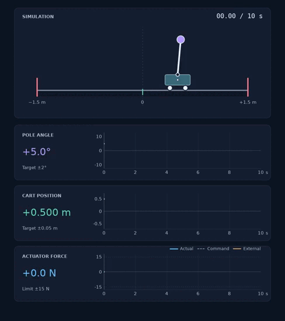

# Cart-pole swing-up and LQR

## Intro

Nonlinear cart-pole swing-up using energy shaping and discrete LQR, with optional Kalman filtering and disturbance compensation. The simulation includes actuator saturation and lag, friction, measurement noise, rail limits, and external pushes.

## Setup

```bash
python -m venv .venv
source .venv/bin/activate
pip install -e .
```

## Run the simulation

```bash
.venv/bin/cartpole-sim config.json
```

Each run saves CSV data, configuration, summary, and MP4 video in `results/`.

## Configuration

Edit [config.json](config.json):

- `simulation`: duration, initial state, actuator, friction, measurement noise/seed, and external force pulses.
- `controller`: control period, LQR Q/R weights, optional `kalman` filter, disturbance observer, and `swing_up` settings.

For automatic Q/R tuning, see [optimization usage](scripts/USAGE.md).

## Results

The example uses Q/R retuned at 50 Hz on the full 10 s swing-up scenario,
including measurement noise, actuator lag, friction and a 5 N push from 4 to 6 s.
The selected weights are `Q = diag(1747.680013, 451.524503, 0.477153,
4625.302535)`, `R = 0.000522409315` (state order: position, velocity, angle,
angular velocity). Full precision is saved in `config.json`.

The image below shows the earlier upright stabilization experiment.


